# Lean Six Sigma DMAIC study of 5 packaging machines: SQL loss-tree analysis found that unexplained idle time, not alarms, drives most OEE loss; an X-bar/R chart isolates the one degrading line.

## Key results
| Metric | Value |
|--------|-------|
| Baseline OEE | 51.7% |
| Idle loss | 27.3% |
| Alarm downtime (top 7/132 codes) = 81.6% |
| Simpson's paradox (2020→2021 per machine) | s_1 −4.5, s_2 +9.5, s_3 +8.2, s_4 +4.0, s_5 +3.8 |
| X-bar/R shift (s_1) | −4.6 pts |
| **Projected** OEE | **61.9%** |

## DMAIC walkthrough
### Define
Project charter: Raise OEE of the packaging-machine fleet (PIADE s_1–s_5) through Lean Six Sigma.  
  
*Note: Replace with actual figure reference from the figures directory.*

### Measure
- OEE by machine:  
  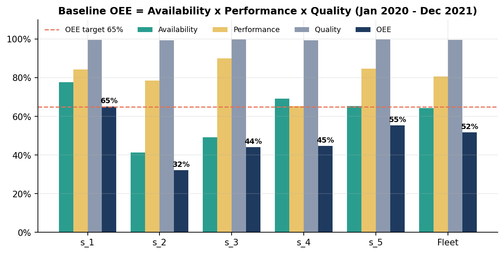
- Loss tree:  
  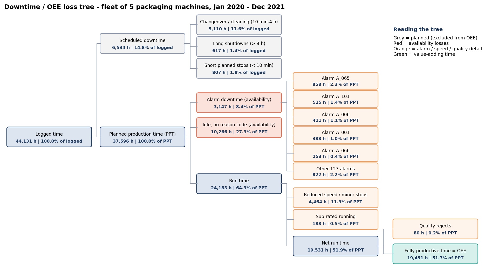
- Pareto of alarm downtime:  
  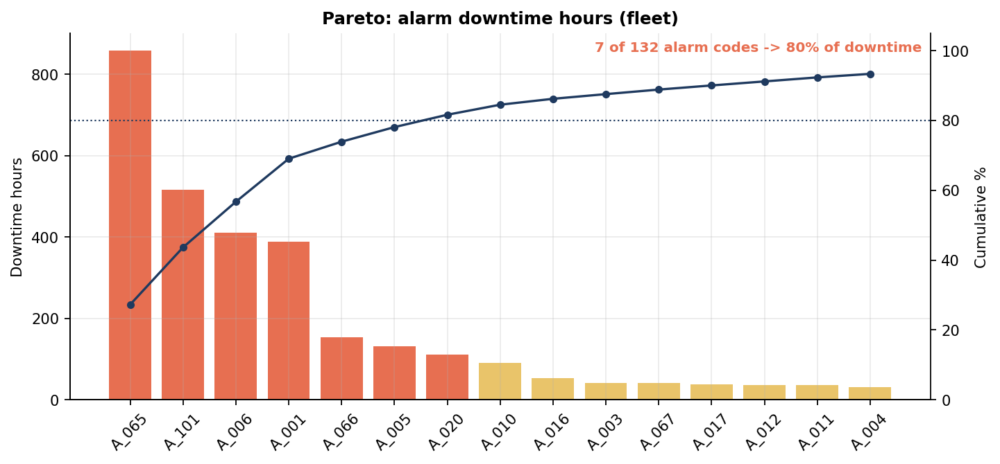

### Analyze
- Fishbone diagram (6M):  
  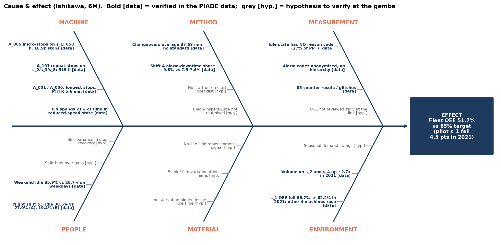
- FMEA vs Pareto:  
  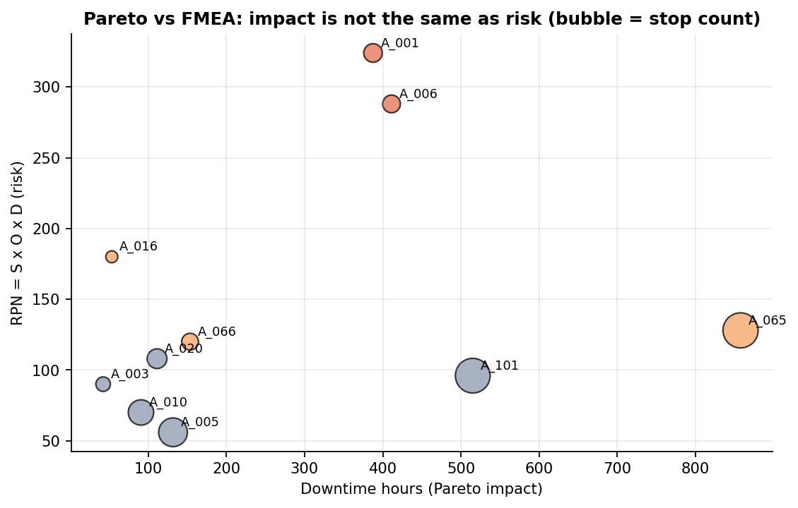
- Hypothesis test table:  
  *(See ANOVA and Welch t results in the section below)*

### Improve
- Current state value stream map:  
  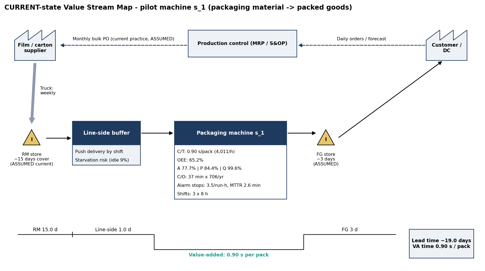
- Future state value stream map:  
  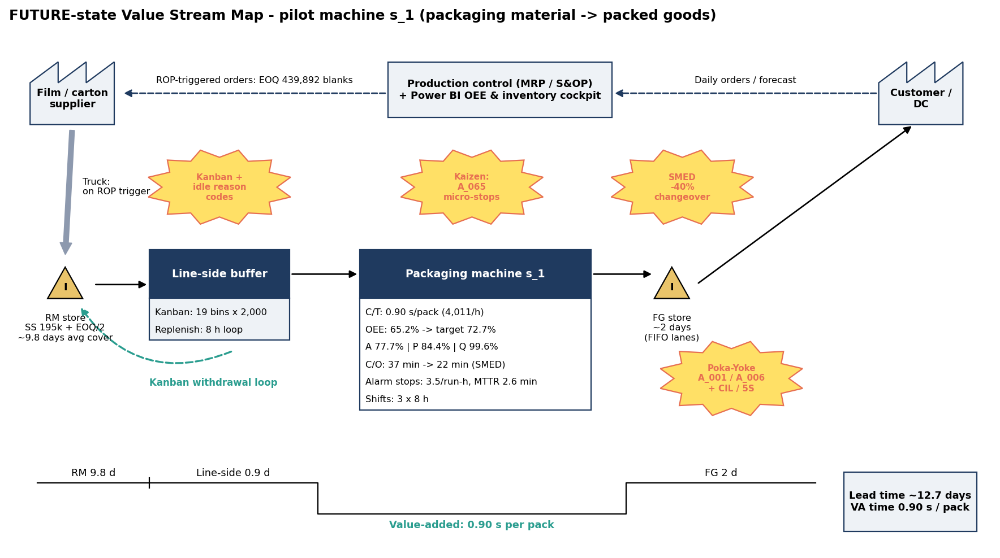
- OEE improvement bridge:  
  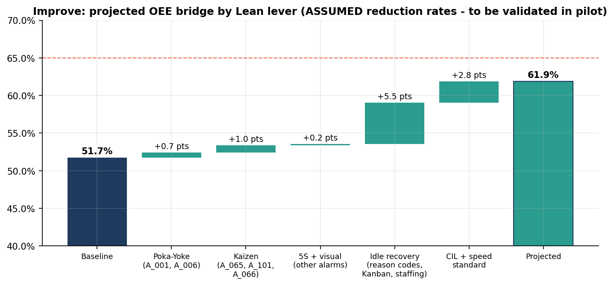
- Backtest service level:  
  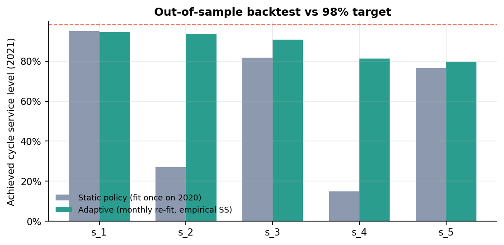

### Control
- X-bar & R chart (s_1):  
  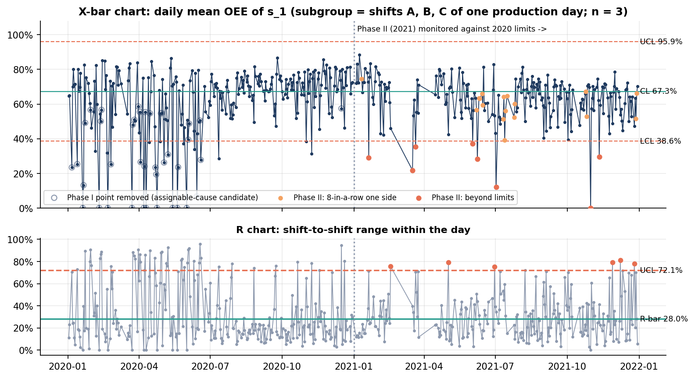
- Capability analysis (s_1):  
  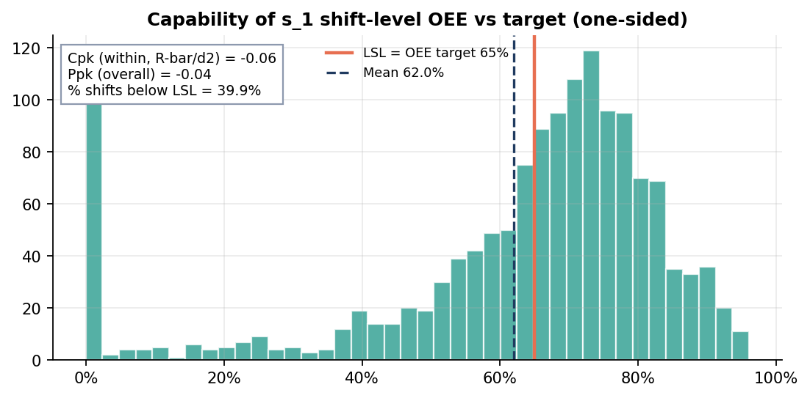
- Control plan: Standard procedures to maintain gains.

## Tech stack and architecture
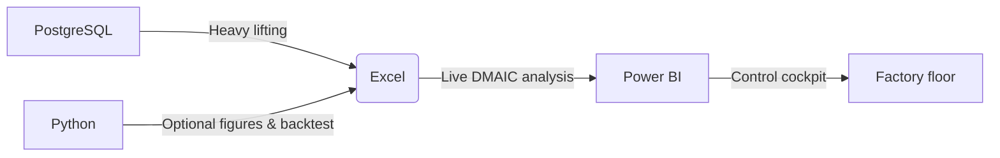

## How to reproduce
```bash
createdb piade
psql -d piade -f sql/01_schema_and_load.sql
psql -d piade -f sql/02_dmaic_views.sql
psql -d piade -f sql/03_export.sql
python excel/build_workbook.py --exports data/exports   # optional rebuild
pip install -r requirements.txt && python python/run_pipeline.py   # optional figures
```

## Repository structure
```
piade-lean-six-sigma-oee/
├── README.md
├── CLAUDE.md                     # copy of this file (optional)
├── LICENSE                       # MIT for code; dataset licence noted separately in README
├── .gitignore
├── requirements.txt
├── data/
│   ├── README.md                 # how to download PIADE and where to put it
│   ├── raw/                      # raw_data.csv, sequences_1h_data.csv  (GIT-IGNORED)
│   └── exports/                  # x_*.csv from sql/03_export.sql + py_*.csv (committed, small)
├── sql/
│   ├── 01_schema_and_load.sql
│   ├── 02_dmaic_views.sql
│   └── 03_export.sql
├── excel/
│   ├── PIADE_LSS_DMAIC_Workbook.xlsx
│   └── build_workbook.py
├── powerbi/
│   ├── PIADE_PowerBI_measures.dax
│   └── model_csv/                # star-schema CSVs
├── python/
│   ├── piade_lss/
│   └── run_pipeline.py
├── figures/                      # PNGs referenced by README
├── reports/
│   ├── PIADE_LSS_DMAIC_Project_Guide.docx
│   └── PIADE_LSS_DMAIC_Project_Guide.pdf
└── docs/
    ├── methodology.md            # OEE definition, production day, shifts, counter logic, X-bar/R design
    └── assumptions.md            # every assumption (mirror of Excel "Inputs" tab + SQL cfg_param)
```

## Assumptions and limitations
- Improve gains are projected from assumed reduction rates, not measured outcomes.
- Alarm codes are anonymised; no description or root-cause data available.
- UTC shift boundaries (A: 06–14, B: 14–22, C: 22–06) are assumed.
- Costs, lead times and changeover identification are assumed.
- Only 39 Phase I subgroups were removed from the X-bar/R chart; they are cause candidates, not proven assignable causes.
- OEE is bounded [0,1], so Cpk/Ppk are indicative only, not absolute capability metrics.

## Dataset credit
PIADE dataset sourced from Kaggle (TODO: add link and authors).